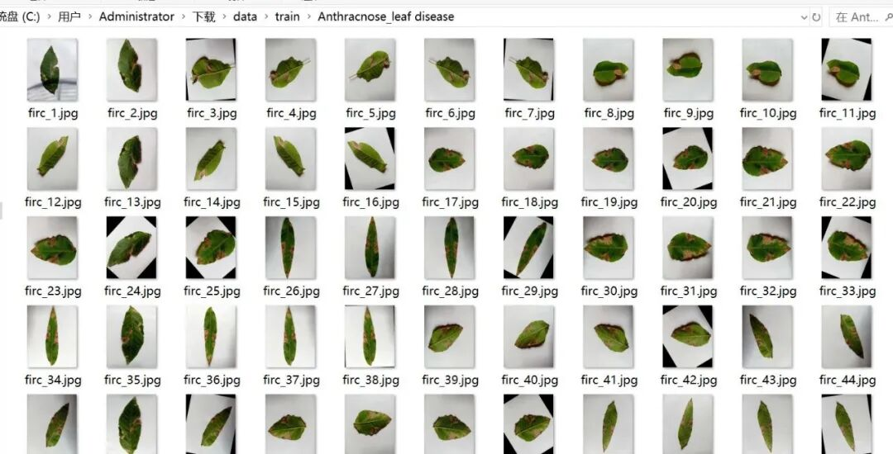
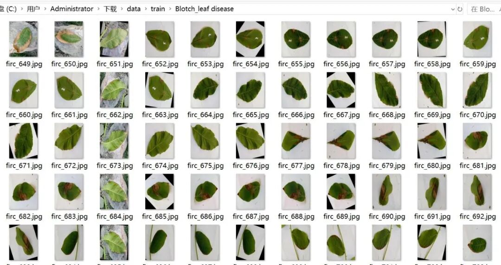
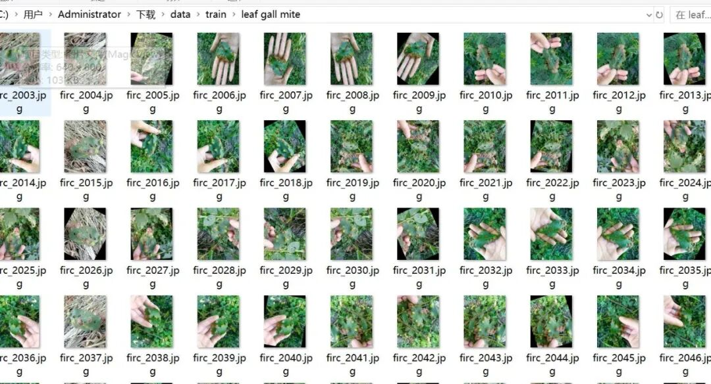
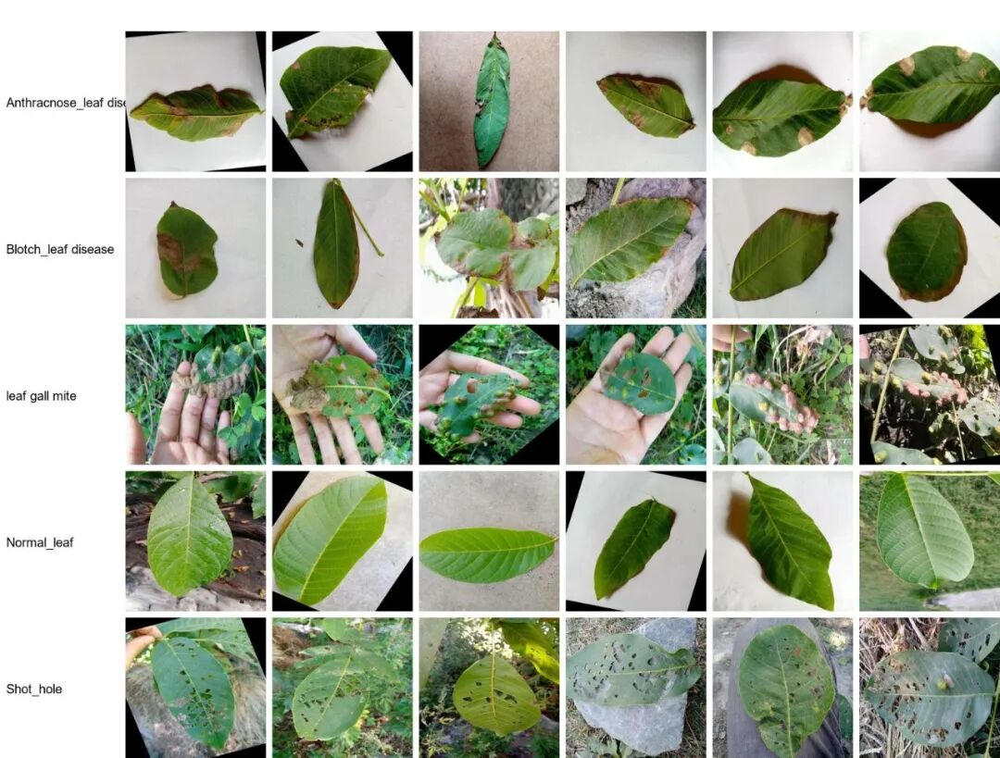

# 5030 images of walnut leaf disease classification dataset with 5 categories

Dataset type: Image classification, not for object detection without annotations.

Dataset format: Only contains jpg images, each category folder contains the corresponding image.

Number of images (number of jpg files): 5030

Category: 5

Image resolution: 640x800

Category Name: ['Anthracnose Leaf Disease', 'Blotch Leaf Disease', 'Normal Leaf', 'Shot Hole', 'Leaf Gall Mite']

Number of images per category:

Number of training set images: 4022

Number of training set images: 4022

Anthracnose Leaf Disease (648 training set images)

- Blotch_leaf disease (Leaf spot/Blotch) training set image count: 1354

- Leaf galling mite (Leaf gall mite) training set image count: 392

- Normal_leaf (normal leaf) training set image count: 712

- Shot_hole (Perforation Disease) training set image count: 916

Number of validation set images: 1008

Anthracnose Leaf Disease (162 images) Validation Set

- Blotch_leaf disease (Leaf spot/Blotch) validation set image count: 339

- Leaf galling mite (Leaf galls) validation set image count: 98

- Normal_leaf (normal leaf) validation set image count: 178

- Shot_hole (Perforation Disease) validation set image count: 231

Test set image count: 0

Total number of images:

Anthracnose Leaf Disease (Total Images: 810)

- Blotch_leaf disease (Leaf spot/Blotch) total image count: 1693

- Leaf galling mite (Leaf galls) total image count: 490

- Normal_leaf (normal leaf) total image count: 890

- Shot_hole (Puncture disease) total image count: 1147

Important Notice: No

Special : This dataset does not guarantee the accuracy of the trained models or weight files.

Image Preview:

Image example:

## Payment

Here is a pay link on Stripe ( https://buy.stripe.com/3cs8yP7sY87d0vu9AB ). Please contact me lonlonago@foxmail.com after funding $89, and I will send you a complete data files , thank you!

